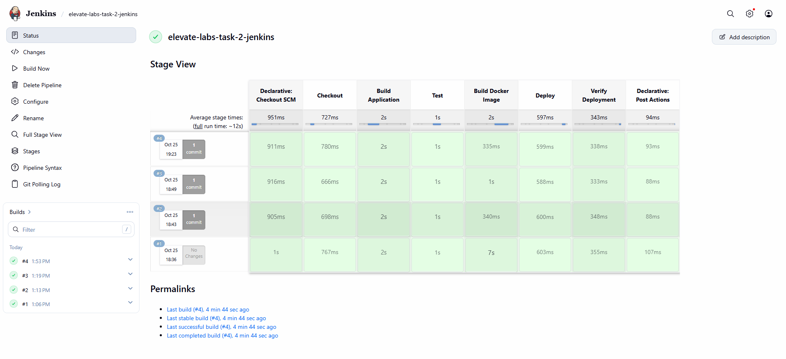
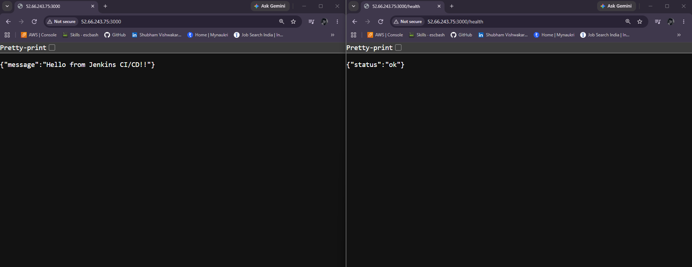

# Elevate Labs Task 2: Jenkins CI/CD Pipeline Using Docker

A beginner-friendly DevOps project that demonstrates how to automate application build, testing, Docker image creation, deployment, and health verification using Jenkins.

This project uses a simple Node.js application, Docker, Jenkins, GitHub, and an Ubuntu server hosted on AWS EC2.

---

## Table of Contents

1. [Project Overview](#1-project-overview)
2. [Project Objectives](#2-project-objectives)
3. [Technologies Used](#3-technologies-used)
4. [Project Structure](#4-project-structure)
5. [Architecture and Workflow](#5-architecture-and-workflow)
6. [Prerequisites](#6-prerequisites)
7. [Application Endpoints](#7-application-endpoints)
8. [Environment Setup](#8-environment-setup)
9. [Configure Jenkins](#9-configure-jenkins)
10. [Understanding the Jenkinsfile](#10-understanding-the-jenkinsfile)
11. [Run the Pipeline](#11-run-the-pipeline)
12. [Verify the Deployment](#12-verify-the-deployment)
13. [Automatic Pipeline Trigger](#13-automatic-pipeline-trigger)
14. [Troubleshooting](#14-troubleshooting)
15. [Security Best Practices](#15-security-best-practices)
16. [Interview Questions and Answers](#16-interview-questions-and-answers)
17. [Learning Outcomes](#17-learning-outcomes)
18. [Conclusion](#18-conclusion)

---

## Screenshots

### Jenkins Pipeline Success


### Application & Health Check


---

## 1. Project Overview

The objective of this project is to create a basic Continuous Integration and Continuous Deployment (CI/CD) pipeline using Jenkins and Docker.

In a manual deployment process, developers may need to check the code, run tests, build a Docker image, deploy the application, and verify that it works.

This project automates these tasks through a Jenkins pipeline defined in a file called `Jenkinsfile`.

When Jenkins detects changes in the configured GitHub repository, it can retrieve the latest source code, run the tests, build a Docker image, deploy the application container, and verify the application's health.

The application runs inside a Docker container on an Ubuntu-based AWS EC2 instance.

### Project details

| Item | Details |
|---|---|
| Project | Elevate Labs Task 2 |
| Objective | Automate application build, testing, and deployment |
| CI/CD tool | Jenkins |
| Application | Node.js |
| Containerization | Docker |
| Source control | Git |
| Code hosting | GitHub |
| Server | AWS EC2 |
| Operating system | Ubuntu |
| Pipeline configuration | Jenkinsfile |
| Application port | 3000 |
| Jenkins web interface | Port 8080 |

## 2. Project Objectives

The main objectives of this project are:

- Install and configure Jenkins on an Ubuntu server.
- Understand the fundamentals of CI/CD.
- Store the application source code in GitHub.
- Define a pipeline using a Jenkinsfile.
- Automate application testing.
- Build a Docker image.
- Deploy the application inside a Docker container.
- Verify application health after deployment.
- Configure Jenkins to detect changes in the GitHub repository.
- Learn basic troubleshooting for Jenkins and Docker.

## 3. Technologies Used

| Technology | Purpose |
|---|---|
| AWS EC2 | Provides the virtual server |
| Ubuntu | Operating system for the server |
| Java | Runtime required by Jenkins |
| Jenkins | Automates the CI/CD workflow |
| Node.js | Runs the web application |
| npm | Runs application scripts and tests |
| Docker | Packages and runs the application |
| Git | Tracks changes to source code |
| GitHub | Hosts the project repository |
| SSH | Provides secure access to EC2 and GitHub |

The project uses open-source software. AWS infrastructure may incur charges depending on the instance type, region, storage, and usage.

## 4. Project Structure

The project uses the following directory structure:

```text
elevate-labs-task-2-jenkins/
│
├── app.js
├── package.json
├── Dockerfile
├── Jenkinsfile
├── .gitignore
│
└── test/
    └── app.test.js
```

### Explanation of each file

| File | Description |
|---|---|
| `app.js` | Creates the Node.js HTTP server and handles application requests |
| `package.json` | Defines project metadata, Node.js requirements, and npm scripts |
| `Dockerfile` | Contains instructions for building the Docker image |
| `Jenkinsfile` | Defines the CI/CD pipeline stages executed by Jenkins |
| `.gitignore` | Specifies files and directories that Git should ignore |
| `test/app.test.js` | Contains the automated test for the application health endpoint |

### How the files work together

1. `app.js` contains the application code.
2. `package.json` defines the commands used to run and test the application.
3. `test/app.test.js` checks whether the application's health endpoint responds correctly.
4. `Dockerfile` packages the application into a Docker image.
5. `Jenkinsfile` automates testing, image building, deployment, and verification.
6. `.gitignore` prevents unnecessary files from being included in Git commits.

## 5. Architecture and Workflow

The project follows this workflow:

```text
Developer
    |
    | Push code changes
    v
GitHub Repository
    |
    | Jenkins checks for changes
    v
Jenkins Pipeline
    |
    +--> 1. Checkout Source Code
    |
    +--> 2. Build Application
    |
    +--> 3. Run Automated Tests
    |
    +--> 4. Build Docker Image
    |
    +--> 5. Deploy Docker Container
    |
    +--> 6. Verify Application Health
    |
    v
Running Node.js Application
    |
    +--> Home Endpoint: /
    |
    +--> Health Endpoint: /health
    |
    v
AWS EC2 Server
```

### Workflow explanation

**Step 1: Source code management**

The application source code is stored in a GitHub repository.

**Step 2: Checkout**

Jenkins retrieves the latest source code from the configured repository.

**Step 3: Build application**

Jenkins checks the Node.js and npm versions and installs the required dependencies.

**Step 4: Test**

Jenkins executes the automated tests using `npm test`. If the tests fail, the later pipeline stages should not run.

**Step 5: Build Docker image**

Docker packages the application into an image using the instructions in the Dockerfile.

**Step 6: Deploy**

Jenkins removes the previous application container, if one exists, and starts a new container using the newly built image.

**Step 7: Verify deployment**

Jenkins sends a request to the `/health` endpoint to confirm that the deployed application is responding.

**Important:** The Docker image is built locally on the EC2 server. This implementation does not publish the image to Docker Hub.

## 6. Prerequisites

Before setting up the project, ensure that you have:

- An AWS account with access to EC2.
- An Ubuntu EC2 instance.
- SSH access to the server.
- Jenkins installed and running.
- A supported Java version for your Jenkins release.
- Docker installed and running.
- Git installed.
- Node.js version 22 or newer and npm available to the pipeline.
- A GitHub account and repository.
- Network access to the required services.

### Verify the installed tools

Run these commands on your EC2 server:

```bash
java -version
```

```bash
git --version
```

```bash
node --version
```

```bash
npm --version
```

```bash
docker --version
```

Check Jenkins and Docker:

```bash
sudo systemctl is-active jenkins
sudo systemctl is-active docker
```

Both commands should return:

```text
active
```

Verify that Jenkins can access Docker:

```bash
sudo -u jenkins -H docker ps
```

This command should run without a Docker permission error.

## 7. Application Endpoints

The Node.js application provides two main endpoints.

### Home endpoint

```text
GET /
```

This endpoint returns a greeting message:

```json
{
  "message": "Hello from Jenkins CI/CD!"
}
```

### Health endpoint

```text
GET /health
```

This endpoint returns:

```json
{
  "status": "ok"
}
```

The health endpoint is used to verify that the application is running and responding to requests.

These endpoints provide a simple way to test the application without requiring a complex frontend or external monitoring system.

## 8. Environment Setup

### Step 1: Connect to the EC2 instance

Connect to the Ubuntu server using SSH:

```bash
ssh -i "YOUR_KEY.pem" ubuntu@YOUR_EC2_PUBLIC_IP
```

Replace `YOUR_KEY.pem` with your SSH private key filename and `YOUR_EC2_PUBLIC_IP` with your instance's public IP address.

Never share your private key.

### Step 2: Navigate to the project directory

```bash
cd ~/elevate-labs-task-2-jenkins
```

### Step 3: Run the application tests

```bash
npm test
```

The tests should complete successfully before deployment.

### Step 4: Build the Docker image manually

You can manually build an image for troubleshooting:

```bash
sudo docker build -t jenkins-cicd-task-2:manual .
```

Check that the image exists:

```bash
sudo docker images
```

Normally, Jenkins performs this build automatically as part of the pipeline.

## 9. Configure Jenkins

### Step 1: Open Jenkins

Open the Jenkins web interface:

```text
http://YOUR_EC2_PUBLIC_IP:8080
```

Sign in with your Jenkins administrator account.

### Step 2: Create a Pipeline job

1. Click **New Item**.
2. Enter the job name:

   `elevate-labs-task-2-jenkins`

3. Select **Pipeline**.
4. Click **OK**.

### Step 3: Configure the GitHub repository

In the Pipeline section, configure the following values:

| Setting | Value |
|---|---|
| Definition | Pipeline script from SCM |
| SCM | Git |
| Repository URL | `git@github.com:shubhkarma666/elevate-labs-task-2-jenkins.git` |
| Branch Specifier | `*/main` |
| Script Path | `Jenkinsfile` |

Click **Save**.

### Step 4: Configure repository credentials if needed

If Jenkins cannot access the GitHub repository, configure the required Git credentials.

The SSH key created for the Ubuntu user is not automatically available to Jenkins. For SSH authentication, add an appropriate Jenkins credential and select it in the Git repository configuration.

Do not store private keys, passwords, or tokens directly in the Jenkinsfile.

### Step 5: Check Jenkins prerequisites

The pipeline needs access to Node.js, npm, Docker, Git, and `curl`.

If a command works in your regular SSH session but fails in Jenkins, verify that the executable is installed and available in Jenkins's environment.

## 10. Understanding the Jenkinsfile

The `Jenkinsfile` is the main configuration file for the pipeline. It defines the stages Jenkins must execute.

### Stage 1: Checkout

```groovy
stage('Checkout') {
    steps {
        checkout scm
    }
}
```

Retrieves the application source code from the configured Git repository.

### Stage 2: Build Application

```groovy
stage('Build Application') {
    steps {
        sh 'node --version'
        sh 'npm --version'
        sh 'npm install --package-lock=false'
    }
}
```

Checks the Node.js and npm environment and installs the required dependencies.

### Stage 3: Test

```groovy
stage('Test') {
    steps {
        sh 'npm test'
    }
}
```

Runs the automated application tests.

If the test stage fails, Jenkins marks the build as failed and normally skips the later stages.

### Stage 4: Build Docker Image

```groovy
stage('Build Docker Image') {
    steps {
        sh 'docker build -t ${IMAGE_NAME}:${BUILD_NUMBER} .'
    }
}
```

Builds a Docker image from the Dockerfile. The Jenkins build number is included in the image tag to distinguish images from different builds.

### Stage 5: Deploy

```groovy
stage('Deploy') {
    steps {
        sh '''
            docker rm -f ${CONTAINER_NAME} 2>/dev/null || true
            docker run -d \
              --name ${CONTAINER_NAME} \
              --restart unless-stopped \
              -p 3000:3000 \
              ${IMAGE_NAME}:${BUILD_NUMBER}
        '''
    }
}
```

Removes the previous application container if it exists and starts a replacement container.

The port mapping `3000:3000` makes the application available on port 3000 of the EC2 host.

Replacing a running container can cause a brief service interruption while the new container starts.

### Stage 6: Verify Deployment

```groovy
stage('Verify Deployment') {
    steps {
        sh '''
            for i in $(seq 1 15); do
              if curl -fsS http://localhost:3000/health; then
                echo "Deployment successful"
                exit 0
              fi
              sleep 2
            done

            echo "Application health check failed"
            docker logs ${CONTAINER_NAME}
            exit 1
        '''
    }
}
```

Checks the application health endpoint and retries if the application has not started yet.

If the endpoint does not respond successfully within the retry period, the pipeline fails and prints the container logs.

### Pipeline trigger

The Jenkinsfile contains:

```groovy
triggers {
    pollSCM('H/2 * * * *')
}
```

This configures Jenkins to check the repository approximately every two minutes for new changes.

This mechanism is called **SCM polling**. It does not provide an instant GitHub webhook notification, and the actual trigger time can vary.

## 11. Run the Pipeline

### Step 1: Start a build

1. Open the Jenkins dashboard.
2. Select the `elevate-labs-task-2-jenkins` job.
3. Click **Build Now**.
4. Select the new build number under Build History.
5. Open **Console Output**.

### Step 2: Observe the pipeline

Jenkins should execute these stages in order:

1. Checkout
2. Build Application
3. Test
4. Build Docker Image
5. Deploy
6. Verify Deployment

### Step 3: Confirm success

A successful build should finish with:

```text
Finished: SUCCESS
```

If a build fails, inspect Console Output and locate the first relevant error.

## 12. Verify the Deployment

### Check the running container

Run on EC2:

```bash
sudo docker ps
```

The application container should be named:

```text
jenkins-demo-app
```

### Check the health endpoint

```bash
curl -i http://localhost:3000/health
```

The response should contain:

```json
{"status":"ok"}
```

### Check the homepage

```bash
curl http://localhost:3000/
```

The response should contain:

```json
{"message":"Hello from Jenkins CI/CD!"}
```

### Open the application in a browser

Visit:

```text
http://YOUR_EC2_PUBLIC_IP:3000/
```

Replace the placeholder with the public IPv4 address of your EC2 instance.

If the application cannot be reached externally, check the container status, port mapping, and EC2 security group. Allow inbound TCP port 3000 only from your own IP when possible.

## 13. Automatic Pipeline Trigger

The pipeline uses SCM polling to detect changes in GitHub.

### Test the trigger

1. Make a small change to an application file.
2. Commit and push the change to the `main` branch.
3. Wait for Jenkins to poll the repository.
4. Open the Jenkins job and inspect Build History.
5. Confirm that a new build starts and completes successfully.

Example commands:

```bash
git add app.js
git commit -m "Test automatic pipeline trigger"
git push origin main
```

Jenkins should detect the new commit and execute the pipeline again.

If no build starts, verify the repository URL, branch configuration, repository credentials, and SCM polling configuration.

## 14. Troubleshooting

### Problem 1: Jenkins is not running

Check the service:

```bash
sudo systemctl status jenkins --no-pager
```

Review the logs:

```bash
sudo journalctl -u jenkins -n 50 --no-pager
```

Check that the installed Java version is supported by your Jenkins release.

### Problem 2: GitHub authentication fails

Check the repository URL and verify that Jenkins has access to the repository.

For SSH authentication, ensure the correct Jenkins credential is configured.

### Problem 3: Node.js is not found

If Jenkins reports `node: not found`, check whether Node.js is installed and available in Jenkins's `PATH`.

```bash
node --version
npm --version
```

Configure the appropriate executable paths if needed.

### Problem 4: Docker permission denied

Check Docker:

```bash
sudo systemctl status docker --no-pager
```

Check the Jenkins user's groups:

```bash
id jenkins
```

If Docker group membership has just been changed, restart Jenkins and test again:

```bash
sudo systemctl restart jenkins
sudo -u jenkins -H docker ps
```

Docker group access is powerful and should only be granted to trusted users.

### Problem 5: Port 3000 is already in use

Check running containers:

```bash
sudo docker ps
```

Check listening processes:

```bash
sudo ss -ltnp | grep ':3000'
```

Resolve the port conflict before retrying deployment.

### Problem 6: The health check fails

Inspect the container logs:

```bash
sudo docker logs jenkins-demo-app
```

Check the container state:

```bash
sudo docker ps -a
```

Test the endpoint:

```bash
curl -i http://localhost:3000/health
```

Review the Jenkins console output for the failed stage.

### Problem 7: The application is inaccessible in a browser

Check that:

- The container is running.
- The application is listening on port 3000.
- Docker maps host port 3000 to container port 3000.
- The EC2 security group allows inbound TCP port 3000 from your IP.

## 15. Security Best Practices

- Restrict SSH access to trusted IP addresses.
- Restrict Jenkins access to trusted users and networks.
- Never commit private keys, passwords, or access tokens to GitHub.
- Store pipeline credentials in Jenkins Credentials when needed.
- Use a non-root container user where practical.
- Expose only the ports required by the project.
- Avoid leaving temporary test ports open.
- Stop or terminate AWS resources when they are no longer needed to avoid unnecessary charges.

## 16. Interview Questions and Answers

### Q1. What is Jenkins, and how is it used in CI/CD?

Jenkins is an automation server used to implement Continuous Integration and Continuous Delivery or Deployment.

It automates tasks such as retrieving source code, running tests, building application packages, and deploying software.

In this project, Jenkins automates testing, Docker image building, container deployment, and health verification.

### Q2. What is a Jenkinsfile?

A Jenkinsfile is a text file that defines the steps of a Jenkins pipeline as code.

It is stored in the source repository so the pipeline configuration can be version-controlled with the application.

In this project, the Jenkinsfile defines the checkout, build, test, Docker build, deploy, and verification stages.

### Q3. How do you create and configure a Jenkins Pipeline?

Install and start Jenkins, create a Pipeline job, and configure it to retrieve source code from GitHub.

Choose **Pipeline script from SCM**, select Git, enter the repository URL and branch, and set the script path to `Jenkinsfile`.

Save the configuration and run a build to verify the setup.

### Q4. What are common stages in a Jenkins pipeline?

Common stages include:

- **Checkout:** Retrieves source code.
- **Build:** Prepares or compiles the application.
- **Test:** Runs automated tests.
- **Package:** Creates an application artifact or container image.
- **Deploy:** Releases the application.
- **Verify:** Checks whether the deployed application works correctly.

The stages depend on the application's requirements.

### Q5. What is the difference between Declarative and Scripted Pipelines?

A Declarative Pipeline uses a structured syntax with sections such as `pipeline`, `agent`, `stages`, `steps`, and `post`. It is generally easier for beginners to understand and maintain.

A Scripted Pipeline uses Groovy scripting and offers more flexibility for complex logic.

This project uses a Declarative Pipeline because its stages are clearly defined and straightforward to follow.

## 17. Learning Outcomes

By completing this project, I learned how to:

- Install Jenkins on an Ubuntu EC2 instance.
- Connect a GitHub repository to Jenkins.
- Define CI/CD stages in a Jenkinsfile.
- Execute automated Node.js tests.
- Build Docker images from a Dockerfile.
- Deploy and replace application containers.
- Verify deployment using an HTTP health endpoint.
- Configure SCM polling for repository changes.
- Troubleshoot Jenkins, Git, Docker, and application errors.
- Document a DevOps project for developers and reviewers.

## 18. Conclusion

This project demonstrates a basic CI/CD workflow using Jenkins, Docker, Node.js, GitHub, and AWS EC2.

The Jenkins pipeline automates application testing, image building, deployment, and health verification. This reduces repetitive manual tasks and provides a consistent way to deliver application updates.

The project provides a foundation for learning more advanced DevOps concepts, including GitHub webhooks, Docker registry publishing, deployment rollback, and infrastructure monitoring.

---

**Project:** Elevate Labs Task 2 — Jenkins CI/CD Pipeline

**GitHub Repository:** [elevate-labs-task-2-jenkins](https://github.com/shubhkarma666/elevate-labs-task-2-jenkins)

